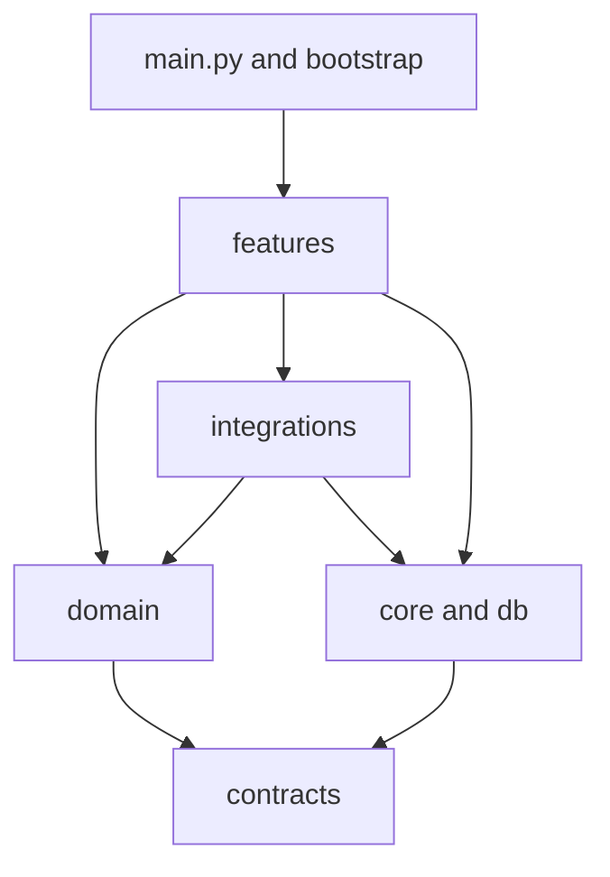
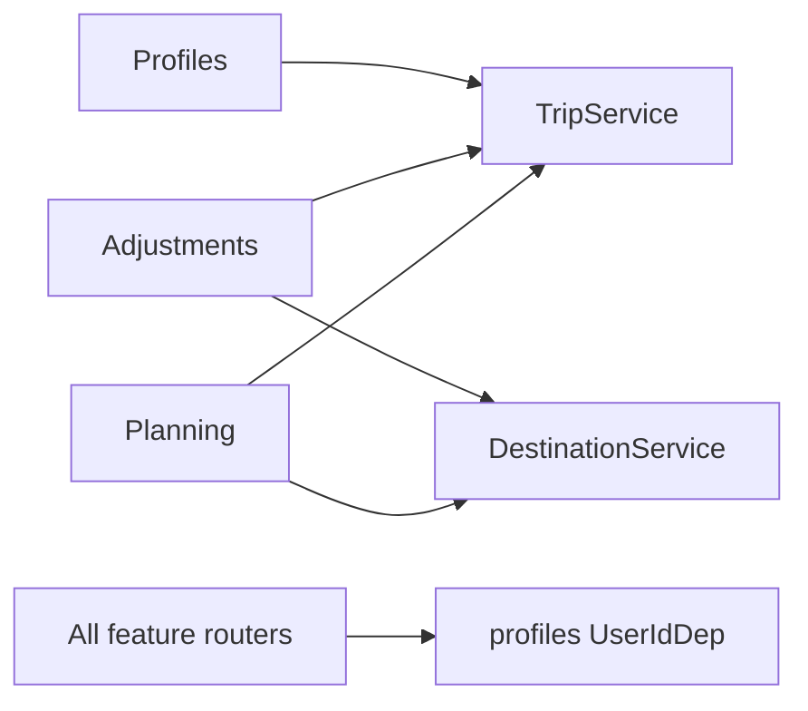

# Backend architecture

The backend is one FastAPI application organized as a modular monolith. For a guided tour of request flows and key abstractions, start with [study-guide.md](study-guide.md). Each feature owns its routes, service,
schemas, tables and queries; shared code sits in a few layers below the features.

## Layers

| Package            | Owns                                                                                         | May import                                                     |
| ------------------ | -------------------------------------------------------------------------------------------- | -------------------------------------------------------------- |
| `contracts/`       | Shared camelCase models (`Trip`, `Day`, `Place`, `Destination`, ...)                         | nothing from `app` but itself                                  |
| `domain/`          | Pure, deterministic travel logic (scheduler, text helpers)                                   | `contracts`                                                    |
| `core/`, `db/`     | Settings, `ApiRouter`, exceptions, ids; `Base`, sessions, model registry                     | `contracts` (`db/registry.py` also imports every model module) |
| `integrations/`    | Provider protocols and implementations (Google, catalog, estimates, LLM client), place cache | `contracts`, `domain`, `core`, `db`                            |
| `features/<name>/` | One product area: HTTP routes, service, schemas, ORM models, repository                      | everything above, and other features' public modules           |
| `bootstrap/`       | Builds providers from settings; seeds catalog and demo data                                  | anything                                                       |
| `main.py`          | App factory, lifespan, middleware, error handler, router registration                        | anything                                                       |

## Feature boundaries

Inside a feature, `service.py`, `schemas.py` and `dependencies.py` are public. Everything else (`models.py`,
`repository.py`, `pipeline.py`, `proposals.py`, ...) is private to that feature.

| Feature     | Tables         | Public interface                                                                |
| ----------- | -------------- | ------------------------------------------------------------------------------- |
| profiles    | `users`        | `UserIdDep` (X-User-Id identity), `ProfileService`                              |
| trips       | `trips`        | `TripService`, `TripDep` (current user's trip or 404)                           |
| discovery   | `destinations` | `DestinationService` (`resolve_for_draft`, `get_for_trip`, ...), `PlaceService` |
| planning    | none           | `PlanningService`                                                               |
| adjustments | `proposals`    | `AdjustmentService`                                                             |

`place_cache` belongs to `integrations/cache.py`.

Trips never imports Planning or Adjustments. Deleting a trip removes its proposals through the database's
`ON DELETE CASCADE`, enforced by PostgreSQL.

## Request flow

- Routers parse HTTP and call one service method. Services raise `AppError` subclasses (`NotFound`, `Conflict`,
`Gone`, ...), which `main.py` renders as `{"detail": ...}` with the same status codes `HTTPException` would use.
- Services for one request share a single `AsyncSession` through FastAPI's dependency cache.
- Provider failures surface as `UpstreamError`; features never import Google modules.
- `POST /trips/generate`: `PlanningService.prepare` resolves the destination and checks the idempotency key
before streaming starts (so errors are plain HTTP errors). The router then streams `step` events while
`PlanningService.generate` runs the LangGraph pipeline and saves the trip, then sends `done` or `error`.
Closing the connection cancels generation.
- Adjust Day: `preview` computes and stores a proposal without touching the trip; `apply` checks expiry (410)
and the trip version (409), then writes the day through `TripService.replace_day`.

## Database

SQLAlchemy 2 async on PostgreSQL. Every model module must be imported in `db/registry.py` so
`python -m app.bootstrap.db init` can create the full schema with `create_all()`. JSON columns are JSONB.
Startup connects to an already initialized database and does not alter tables.