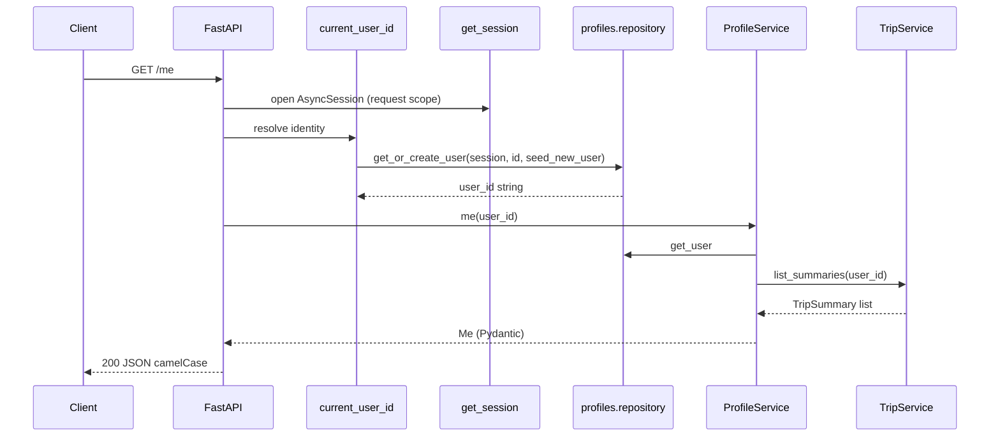

# Backend study guide

A guided path through the Wayfare backend on the modular layout (`app/features/`, `app/integrations/`, …). The goal is not to read every file in alphabetical order, but to follow **one complete request** through the system, then study the abstractions that request depends on.

**Companion docs:** [architecture.md](architecture.md) (layer rules and module map), [contributing.md](contributing.md) (where to put new code, Neon PostgreSQL).

**How to use this guide**

- Work in order (Stage 1 → 5). Each stage builds on the last.
- Keep the suggested time boxes as a pace check, not a deadline.
- After each stage, try the **checkpoint** without opening the repo. If you cannot, re-read only the files listed for that stage.
- Run the API locally (`uv run uvicorn app.main:app --reload`) and hit `/docs` while you read; it makes dependencies and response shapes concrete.

---

## Stage 1 — Application startup and a simple API request

**Suggested time:** 45–60 minutes

### Files to read (in order)

| Order | File | Why |
| --- | --- | --- |
| 1 | [`app/main.py`](../backend/app/main.py) | App factory, lifespan, router registration, global error handler |
| 2 | [`app/features/profiles/router.py`](../backend/app/features/profiles/router.py) | Thinnest possible HTTP layer |
| 3 | [`app/features/profiles/dependencies.py`](../backend/app/features/profiles/dependencies.py) | FastAPI `Depends`, identity, service wiring |
| 4 | [`app/features/profiles/service.py`](../backend/app/features/profiles/service.py) | Business orchestration (no SQL) |
| 5 | [`app/features/profiles/repository.py`](../backend/app/features/profiles/repository.py) | SQLAlchemy access for `users` |

Skim once: [`app/core/routing.py`](../backend/app/core/routing.py) (`ApiRouter` forces `response_model_exclude_none=True` so JSON matches the Expo app).

### What happens at startup

When Uvicorn loads `app.main:app`, it calls `create_app()` (unless tests inject their own).

1. **Lifespan** runs before the server accepts traffic. Tables must already exist (`python -m app.bootstrap.db init`); startup does not create them.
   - One short-lived session runs `bootstrap.seed.seed_catalog()` (curated destinations into `destinations`).
   - `app.state.services = build_services(settings)` — see Stage 4 for what that contains.
   - `app.state.seed_new_user` is set to `bootstrap.seed.seed_new_user` (demo trip hook for new users).
2. On shutdown: close HTTP clients in `Services`, then `dispose_engine()`.

Routers are included in a fixed order: health, profiles, places, destinations, trips, planning (generate), adjustments. All feature routers use `ApiRouter`, so optional fields are omitted from JSON when null.

### Trace: `GET /me`

Assume header `X-User-Id: tester-abc` (or omit it to use `default_user_id` from settings, usually `demo-user`).



Step by step:

1. **Route** `get_me(profiles: ProfileServiceDep, user_id: UserIdDep)` — FastAPI resolves dependencies **before** the handler body runs.
2. **`SessionDep`** — `get_session()` yields one `AsyncSession` per request. Every dependency that asks for `SessionDep` in the same request gets the **same** session instance (FastAPI caches dependency results per request).
3. **`UserIdDep`** — `current_user_id()`:
   - Reads `X-User-Id` or falls back to `get_settings().default_user_id`.
   - Validates format (`^[A-Za-z0-9_-]{3,64}$`) or returns 400.
   - Calls `get_or_create_user(session, user_id, app.state.seed_new_user)`. That may `commit()` a new user (and optionally seed a demo trip via the hook). Existing users are a single `session.get`.
4. **`ProfileServiceDep`** — `ProfileService(session, TripService(session))`. Note that `TripService` is constructed with the **same** session, so trip counts in `/me` see committed data from step 3.
5. **`profiles.me(user_id)`** — Loads `User` from DB, calls **`TripService.list_summaries`** (cross-feature call through the public trips API, not `trips.repository` directly), builds `Me` with `Stats` and computed `initials`.
6. **Response** — `response_model=Me` serializes with camelCase aliases; `ApiRouter` drops null optional fields.

The router never runs SQL. It only declares types and calls one service method. That pattern repeats for trips, discovery, planning, and adjustments.

### Related requests (same pattern)

- `GET /me/preferences` — same dependencies; `ProfileService.preferences` reads `user.default_prefs` JSON.
- `PUT /me/preferences` — body parsed as `Preferences`; repository `save_default_prefs` commits.

### Checkpoint

**Can you explain `GET /me` without looking at the code?**

You should be able to say: startup seeds catalog and builds `Services`; each request gets one DB session; identity is resolved first via header or demo default, creating the user if needed; the profile service loads the user and asks trip service for summaries to fill stats; response is a Pydantic `Me` with camelCase JSON. Routers stay thin; SQL lives in repositories.

---

## Stage 2 — Persistence and transactions

**Suggested time:** 60–90 minutes

### Files to read

| Area | Files |
| --- | --- |
| DB core | [`app/db/base.py`](../backend/app/db/base.py), [`app/db/session.py`](../backend/app/db/session.py), [`app/db/registry.py`](../backend/app/db/registry.py) |
| Trips | [`app/features/trips/models.py`](../backend/app/features/trips/models.py), [`app/features/trips/repository.py`](../backend/app/features/trips/repository.py), [`app/features/trips/service.py`](../backend/app/features/trips/service.py), [`app/features/trips/dependencies.py`](../backend/app/features/trips/dependencies.py), [`app/features/trips/router.py`](../backend/app/features/trips/router.py) |
| Contracts | [`app/contracts/travel.py`](../backend/app/contracts/travel.py) (`Trip`, `Day`, …) |

### Two representations of “a trip”

| | `Trip` (Pydantic, `contracts/travel.py`) | `TripRow` (SQLAlchemy, `features/trips/models.py`) |
| --- | --- | --- |
| Used by | HTTP responses, planner output, adjustment previews | Database reads/writes |
| Shape | Nested `days` with `Activity` objects, camelCase via `.dump()` | Flat columns + `prefs` and `days` as JSON blobs |
| Versioning | `version` field on the contract | `version` column; incremented in `replace_day` |
| Ownership | No `user_id` on contract (scoped in service layer) | `user_id` FK to `users` |

Conversion lives in the trips **repository**: `trip_from_row`, `summary_from_row`, `_trip_row`. Services and other features should use **`Trip`**, not `TripRow`. `TripDep` in `trips/dependencies.py` loads a `Trip` for the current user or 404s before the route handler runs.

### Trace: `GET /trips` and `GET /trips/{trip_id}`

- **List:** `list_trips` → `TripService.list_summaries` → `repository.list_trip_rows` (ordered by `created_at` desc) → map each row to `TripSummary` (lighter than full `Trip`).
- **Get one:** `TripDep` calls `trips.get(user_id, trip_id)`; handler returns the `Trip` unchanged.

### Trace: `DELETE /trips/{trip_id}`

1. `TripDep` ensures the trip exists and belongs to the user.
2. `TripService.delete` loads the row again, raises `NotFound` if missing.
3. `repository.delete_trip`: `session.delete(row)` then `commit()`.

No code in the trips feature deletes `proposals` rows explicitly.

### Why deleting a trip deletes its proposals

- Table `proposals` has `trip_id` → `trips.id` with **`ondelete="CASCADE"`** (see [`features/adjustments/models.py`](../backend/app/features/adjustments/models.py)).
- On **Postgres**, the database enforces this automatically.

This keeps **trips** from importing **adjustments** just to clean up proposal rows.

### Transactions and `commit()` boundaries

Repositories own commits today (not a unit-of-work wrapper):

| Function | Commits? | Notes |
| --- | --- | --- |
| `get_or_create_user` | Yes, on create | Handles `IntegrityError` for concurrent first requests |
| `save_default_prefs` | Yes | |
| `save_trip` / `delete_trip` / `replace_day` | Yes | |
| `create_proposal` | Yes | Also deletes expired proposals in the same transaction |
| `stage_trip` | No | Used inside user-creation transaction for demo trip |

**Per-request session:** Most routes use one `SessionDep`. Multiple service calls in one handler share that session until the request ends.

**Exception — generation:** `TripService.save_generated` opens a **new** session via `get_sessionmaker()`. The SSE handler may outlive the request-scoped session; generation runs in a background task inside the same HTTP connection but needs its own commit scope. It also handles duplicate `Idempotency-Key` with `IntegrityError` → return the existing trip.

### Why `db/registry.py` imports every model

SQLAlchemy only knows about tables whose model classes are imported before `Base.metadata` is used. The registry imports `User`, `TripRow`, `DestinationRow`, `ProposalRow`, and `PlaceCacheRow` so `create_tables()` sees the whole schema.

If you add a model file and forget the registry, `python -m app.bootstrap.db init` will not create that table.

### Checkpoint

**Why does deleting a trip remove adjustment proposals?**

Foreign key `proposals.trip_id` → `trips.id` with `ON DELETE CASCADE`. PostgreSQL enforces that constraint. Trips does not call into the adjustments repository on delete.

---

## Stage 3 — LangGraph and streamed generation

**Suggested time:** 90–120 minutes

### Files to read (in order)

| Order | File |
| --- | --- |
| 1 | [`app/features/planning/router.py`](../backend/app/features/planning/router.py) — SSE transport, cancellation |
| 2 | [`app/features/planning/service.py`](../backend/app/features/planning/service.py) — `prepare` vs `generate` |
| 3 | [`app/features/planning/pipeline.py`](../backend/app/features/planning/pipeline.py) — graph, `PlanState`, `run_planner` |
| 4 | [`app/features/planning/curation.py`](../backend/app/features/planning/curation.py) — prompts, structured output, `validate_choice` |

Supporting context (as needed): [`app/features/planning/schemas.py`](../backend/app/features/planning/schemas.py) (`TripDraft`), [`app/domain/scheduler.py`](../backend/app/domain/scheduler.py) (deterministic schedule after curation).

### `prepare()` vs `generate()`

| | `PlanningService.prepare` | `PlanningService.generate` |
| --- | --- | --- |
| When | Before `EventSourceResponse` starts streaming | Inside the async worker task |
| Purpose | Resolve destination, check idempotency, allocate `trip_id` | Run LangGraph, persist trip |
| Errors | HTTP exceptions (`BadGateway`, `Unprocessable`, …) | SSE `error` events (or timeout) |
| Idempotency | If `Idempotency-Key` matches an existing trip, sets `prepared.existing` | Skipped when replaying |

The router calls `prepare` synchronously on the request thread so destination failures are normal HTTP status codes, not SSE payloads.

### SSE event shape

Router emits Server-Sent Events:

- `step` — `{"index": 0..4, "label": STEP_LABELS[i]}` (planner progress labels).
- `done` — `{"trip": <Trip.dump()>}`.
- `error` — `{"message": "...", "retryable": true|false}`.

Implementation detail: an `asyncio.Queue` bridges the worker task and the generator. The client sees an initial `step` for index 0, then further `step` events from `on_step` callbacks as graph nodes complete (`NODE_STEP` maps nodes to indices 1–4). When the worker finishes, one final non-`step` event (`done` or `error`) ends the stream. Disconnecting cancels the worker task in a `finally` block.

Idempotent replay: if `prepared.existing` is set, the handler returns a minimal stream that only yields `done`.

### Graph topology

```
START → fetch_candidates → normalize → curate → validate
                              ↑            |
                              |     (errors, attempts ≤ CURATE_MAX_RETRIES)
                              +------------+
                              |
                    (errors, out of retries) → fallback → schedule → legs → finalize → END
                              |
                    (no errors) → schedule → ...
```

- **`fetch_candidates`** — `services.places.candidates(dest, prefs)` (catalog or Google).
- **`normalize`** — Dedupe, rank, assign short aliases `c1`, `c2`, … for the LLM; reset `attempts`.
- **`curate`** — If no LLM: `_heuristic` → `heuristic_curate` in scheduler. Else structured `TripPlanChoice`; on model failure, heuristic. Increments `attempts` on each LLM call.
- **`validate`** — Skipped for heuristic. For LLM: `validate_choice` in `curation.py` (unknown ids, duplicate ids, meal slots, closed days, sight counts).
- **`after_validate`** — No errors → `schedule`. Errors and `attempts <= curate_max_retries` (default 2) → back to `curate` with `errors` in state (fed into the next prompt). Otherwise → `fallback` (heuristic plan).
- **`schedule` / `legs` / `finalize`** — Pure domain math + `resolve_legs` for real travel times; output is a `Trip` contract.

`run_planner` passes `Services` through LangGraph config: `config["configurable"]["services"]`.

### Checkpoint: LLM picks invalid candidates three times

Assume `CURATE_MAX_RETRIES=2`, LLM configured, and every `curate` returns a structurally invalid plan (e.g. unknown candidate id).

1. **Attempt 1:** `curate` → `validate` sets `errors`, `attempts=1` → `after_validate` → `curate` again with feedback in messages.
2. **Attempt 2:** `curate` → `validate`, `attempts=2` → still errors → `curate` again.
3. **Attempt 3:** `curate` → `validate`, `attempts=3` → `after_validate`: `attempts > curate_max_retries` → **`fallback`** (heuristic curator, no more LLM retries).
4. **`schedule` → `legs` → `finalize`** — User still gets a trip; generation succeeds unless candidates were empty or timeout.

If the LLM throws on invoke, `_heuristic` runs immediately inside `curate` (no retry loop for that failure mode).

Tests: [`tests/test_graph.py`](../backend/tests/test_graph.py) exercises validation, retries, and fallback with a fake LLM.

---

## Stage 4 — Integrations and dependency inversion

**Suggested time:** 60–90 minutes

### Files to read

| File | Role |
| --- | --- |
| [`app/integrations/services.py`](../backend/app/integrations/services.py) | `Services` dataclass, `ServicesDep` |
| [`app/bootstrap/providers.py`](../backend/app/bootstrap/providers.py) | Chooses Google vs offline implementations |
| [`app/integrations/places/protocol.py`](../backend/app/integrations/places/protocol.py) | `PlaceProvider` interface |
| [`app/integrations/places/catalog.py`](../backend/app/integrations/places/catalog.py) | Offline catalog provider |
| [`app/integrations/places/google.py`](../backend/app/integrations/places/google.py) | Google Places (New) provider |
| [`app/integrations/routing/protocol.py`](../backend/app/integrations/routing/protocol.py) | `TravelRouter` interface |
| [`app/integrations/routing/estimates.py`](../backend/app/integrations/routing/estimates.py) | No-op travel times |
| [`app/integrations/routing/google.py`](../backend/app/integrations/routing/google.py) | Routes API matrices / polylines |
| [`app/integrations/routing/legs.py`](../backend/app/integrations/routing/legs.py) | `resolve_legs` used by planner and adjustments |
| [`app/integrations/cache.py`](../backend/app/integrations/cache.py) | TTL cache for Google payloads |

### How one codebase runs with or without Google

`build_services(settings)`:

- **No `GOOGLE_MAPS_API_KEY`:** `CatalogPlaceProvider` + `EstimateTravelRouter`. Cities come from bundled `catalog.json`; travel legs use distance heuristics in `domain/scheduler.py`.
- **With key:** `GooglePlaceProvider` + `GoogleTravelRouter`, shared `PlaceCache`, HTTP clients closed on shutdown.

Optional `LLM_MODEL` is independent: heuristic curation works without it; with it, planning uses structured output unless validation keeps failing (Stage 3).

Planning code (`pipeline.py`, `fetch_candidates`, `resolve_legs`) only depends on **`Services.places`**, **`Services.router`**, and **`Services.llm`** — not on `google.py` or `catalog.py` directly.

### Testing without credentials

[`tests/conftest.py`](../backend/tests/conftest.py) `make_client` builds `create_app(Services(...))` with `CatalogPlaceProvider` and `EstimateTravelRouter`, optionally a `FakeStructuredLLM`. No network; same code paths as offline mode.

[`tests/test_google.py`](../backend/tests/test_google.py) mocks HTTP with `httpx` transports for Google client behavior.

### Checkpoint: third place provider

**How would you add a third `PlaceProvider` without editing the planning pipeline?**

1. Implement the `PlaceProvider` protocol in e.g. `integrations/places/my_provider.py` (`source` literal, all async methods).
2. Extend `build_services()` to construct it when some new setting is set (or compose a facade that delegates).
3. Inject via `create_app(services=...)` in tests.

Do **not** import the new module from `features/planning/`. Only `bootstrap/providers.py` and tests need to know the implementation name. The pipeline already calls `services.places.candidates`, `get_place`, etc.

Same idea for routing: implement `TravelRouter` and swap in `build_services`.

---

## Stage 5 — Adjustments, consistency, and testing

**Suggested time:** 90 minutes

### Files to read

| Order | File |
| --- | --- |
| 1 | [`app/features/adjustments/router.py`](../backend/app/features/adjustments/router.py) |
| 2 | [`app/features/adjustments/service.py`](../backend/app/features/adjustments/service.py) |
| 3 | [`app/features/adjustments/repository.py`](../backend/app/features/adjustments/repository.py) |
| 4 | [`app/features/adjustments/proposals.py`](../backend/app/features/adjustments/proposals.py) — deterministic adjust kinds |
| 5 | [`app/features/adjustments/agent.py`](../backend/app/features/adjustments/agent.py) — `custom` kind, tool-calling agent |
| 6 | [`tests/test_api.py`](../backend/tests/test_api.py) — preview/apply, replace flow |
| 7 | [`tests/test_graph.py`](../backend/tests/test_graph.py) — planner validation (parallel skills: fakes, structured output) |

### Preview vs apply

| | Preview (`POST .../proposals`) | Apply (`POST .../proposals/{id}/apply`) |
| --- | --- | --- |
| Trip row | Unchanged | One day replaced, `version += 1`, `adjusted = true` |
| Persistence | Inserts `ProposalRow` if `changes` non-empty | Deletes proposal row after success |
| User sees | `Proposal` with `changes` and optional `proposal_id` | Full updated `Trip` |

`proposals.py` functions are **pure** over `Trip` + `Services` (re-time via `resolve_legs` + `retime_day`). `AdjustmentService.preview` dispatches on `ProposalRequest.kind`, then `repository.create_proposal` stores the proposed day JSON and `base_version = trip.version` at preview time.

### Expiry and version checks (`apply`)

1. Load `ProposalRow` by id and `trip_id`; 404 if missing.
2. **`expires_at`** vs `utcnow()` → **410 Gone** with message to open Adjust Day again (`proposal_ttl_s`, default 30 minutes). Expired rows are also bulk-deleted when creating new proposals.
3. **`base_version != trip.version`** → **409 Conflict** (trip changed since preview — e.g. another apply or edit). `trip` here is the current `Trip` from `TripDep`, loaded at request start.
4. `TripService.replace_day` writes the stored day JSON; `delete_proposal` commits removal of the preview.

Preview does **not** bump `version`; only apply does.

### Agent path (`kind: custom`)

`agent.py` builds LangChain tools over a **working copy** of the day (`WorkingDay`), searches places via `services.places.nearby`, then `finish` + `diff_days` like other kinds. Requires `services.agent_enabled` (LLM supports tool binding); otherwise `PlanningError` → 400/503 via `AppError`.

### Concurrent writes (current behavior and gap)

**What works today**

- Optimistic check: apply compares `prop.base_version` to current `trip.version`.
- Two tabs applying the same proposal: second may 409 if the first already applied.
- Stale proposal after edit: 409.

**What is not atomic**

`apply` does: read trip version → read proposal → `replace_day` (read row, write, commit) → delete proposal. Two clients with **different** valid proposals could interleave: both pass the version check if they read the same `version` before either commits; last write wins on `days` JSON without comparing proposal ids.

**Checkpoint: how would you prevent conflicting applies?**

Reasonable directions (not implemented yet; pick one in a focused PR):

1. **Single SQL update:** `UPDATE trips SET days = :days, version = version + 1 WHERE id = :id AND version = :expected` — if `rowcount == 0`, return 409. Apply and version bump in one statement.
2. **Row lock:** `SELECT ... FOR UPDATE` on `TripRow` for the duration of apply, combined with the version check.
3. **Proposal consumption:** `UPDATE proposals SET consumed = true WHERE id = :id AND trip_id = :tid` before mutating trip, or delete proposal first in the same transaction as the trip update.
4. **ETag / If-Match** on apply endpoint carrying `trip.version` for clearer clients.

Add integration tests that fire two concurrent `apply` requests and assert exactly one succeeds.

### Tests worth knowing

| Test file | What it teaches |
| --- | --- |
| `test_api.py` | End-to-end HTTP, SSE generation, adjust preview/apply, idempotency |
| `test_graph.py` | Fake LLM queue, validation retries, heuristic fallback |
| `test_adjust_parity.py` | Python adjust matches TS fixtures |
| `test_scheduler_parity.py` | Scheduler matches Expo `generate.ts` |
| `test_contract.py` | Pydantic models still match `frontend/src/domain/types.ts` |
| `conftest.py` | `make_client` pattern for injecting `Services` |

---

## Quick reference: feature public surfaces

When reading or extending code, prefer crossing feature boundaries only through:

| Feature | Import from |
| --- | --- |
| Identity | `features.profiles.dependencies.UserIdDep` |
| Trips | `features.trips.service.TripService`, `features.trips.dependencies.TripDep` |
| Destinations / places HTTP | `features.discovery.service.DestinationService`, `PlaceService` |
| Generation | `features.planning.service.PlanningService` |
| Adjustments | `features.adjustments.service.AdjustmentService` |
| External APIs | `integrations.services.Services` / `ServicesDep` (in routers), never Google modules in features |

---

## Suggested next steps after Stage 5

- Pick a small change (e.g. new `AdjustKind`) and implement it using [contributing.md](contributing.md).
- After a model change, create a fresh Neon database and run `uv run python -m app.bootstrap.db init --seed`. `create_all()` does not alter existing columns.
- Trace `POST /destinations/resolve` or `GET /places/autocomplete` using the same router → service → repository/provider pattern as Stage 1.
