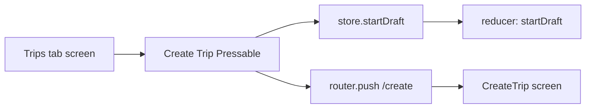
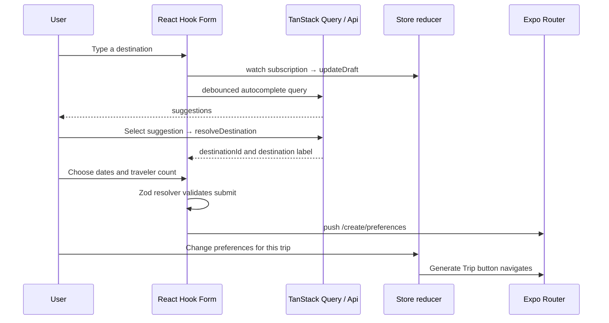
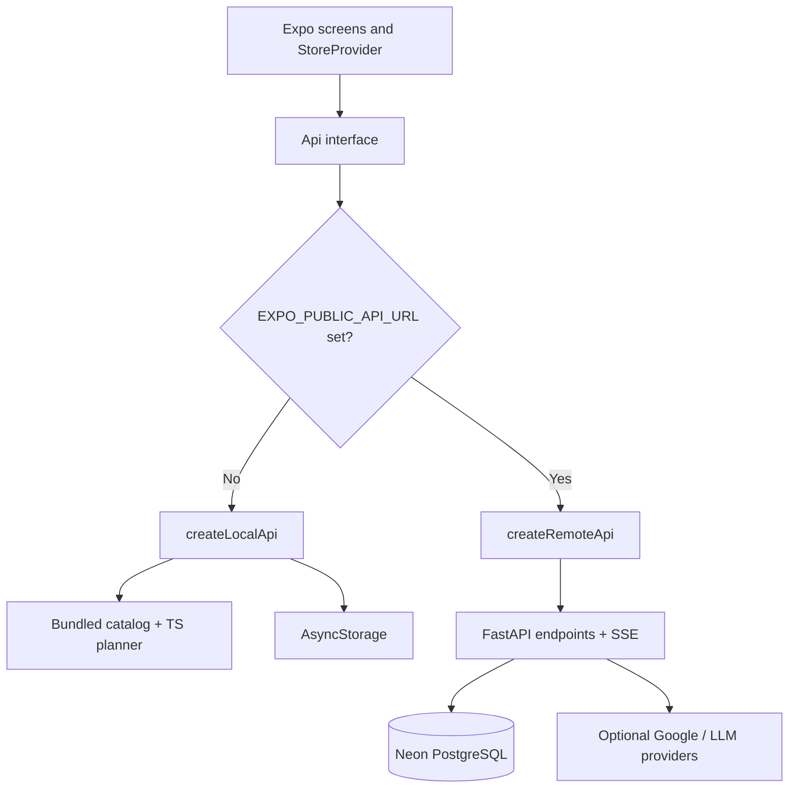
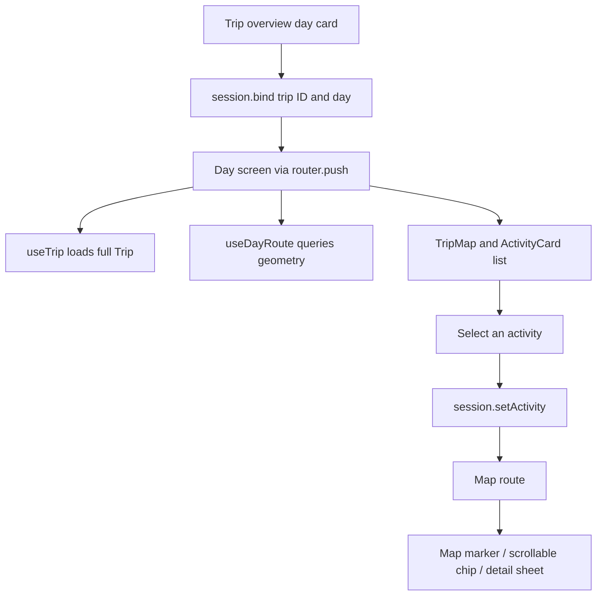
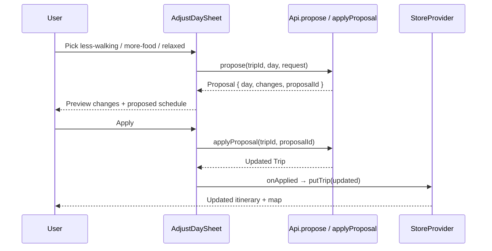

# Wayfare frontend study guide

A staged, code-first walkthrough of the **Expo + React Native** app. This is the frontend companion to [`backend-study-guide.md`](backend-study-guide.md). Rather than reading every file in alphabetical order, follow **one trip from the home screen to creation, generation, itinerary, map, and adjustment**. Each stage explains the ownership of state, code boundaries, and how to verify your understanding.

> **Placement:** This guide lives at `docs/frontend-study-guide.md` in the repository root. Source links are relative to this location. The instructions describe the `main` branch reviewed on October 11, 2026; revisit the code when the app evolves.

**Companion reading:** [Project README](../README.md), [backend README](../backend/README.md), [backend architecture](architecture.md), [frontend package.json](../frontend/package.json), and [frontend AGENTS.md](../frontend/AGENTS.md) (a few general suggestions in `AGENTS.md` differ from the actual repo layout, so follow the code).

## How to use this guide

1. Complete Stages 1–5 in order. Each stage has a suggested time, ordered files, a concrete request/UI trace, and an exercise.
2. Keep Expo running while reading; use a device/simulator when possible. Switch between **offline** and **remote** modes to see the architectural seam.
3. Answer each **checkpoint** from memory before reading its expected answer. If stuck, reread only that stage's files.
4. Prefer small reversible changes in a feature branch. Run the tests before and after experiments.
5. For cross-platform behavior, explicitly ask whether the code runs on **web, iOS, Android, or all three**.

### Start the app (offline first)

From the repository root, use Node.js 22:

```bash
cd frontend
npm ci
npm start
```

The offline planner needs **no backend or API keys**. Leave `EXPO_PUBLIC_API_URL` unset (or blank) and run on Expo's supported target. `npm run web` starts the browser version. iOS simulator requires Xcode on macOS; Android emulator requires Android Studio and an emulator. Expo Go and custom development builds are **not interchangeable** when native modules or config plugins require a rebuild.

For remote mode, run the FastAPI backend as described in the [project README](../README.md), then copy [`frontend/.env.example`](../frontend/.env.example) to `frontend/.env.local` and set `EXPO_PUBLIC_API_URL=http://localhost:8000`. Restart Expo. On physical devices, phone and computer must be network-reachable; [`src/config.ts`](../frontend/src/config.ts) rewrites development localhost addresses where it can. **Do not put Neon, Gemini, or server-side Maps secrets in `EXPO_PUBLIC_*` variables.**

### Map of the codebase

```text
frontend/
├── app/                          Expo Router screens, nested layouts
│   ├── _layout.tsx               Root providers and Stack
│   ├── (tabs)/                   Trips, Explore, Profile
│   ├── create/                   Destination form → preferences → generating
│   └── trip/[id]/                Overview, daily itinerary, map
├── src/
│   ├── components/               Reusable UI, trip cards, sheets, native map
│   ├── state/                    Global app store and in-trip UI session
│   ├── lib/api/                  Api interface, local adapter, remote adapter, SSE
│   ├── lib/                      Storage, hooks, polyline, helpers
│   ├── domain/                   Shared types, Zod schemas, offline planner logic
│   ├── config.ts                 Resolve API URL for web/emulator/device
│   └── theme.ts                  Colors, fonts, spacing, touch size
├── app.config.ts                 Native app config and Maps plugin
└── package.json                  Expo SDK 57, scripts, dependencies
```

One principle to keep in mind: **screens render and coordinate interactions; state providers own shared client state; the `Api` interface hides where data comes from; pure domain functions calculate plans in offline mode.**

---

## Stage 1 — Application startup, navigation, and React Native UI

**Suggested time:** 45–60 minutes  
**Goal:** Understand how the app boots, why screens can access shared state, and how a tap becomes navigation.

### Read these files in order

| Order | File | Look for |
| --- | --- | --- |
| 1 | [`package.json`](../frontend/package.json), [`app.config.ts`](../frontend/app.config.ts) | Expo SDK, React Native, plugins, native map configuration |
| 2 | [`app/_layout.tsx`](../frontend/app/_layout.tsx) | Fonts, splash screen, `QueryClientProvider`, `StoreProvider`, `TripSessionProvider`, root `Stack` |
| 3 | [`app/(tabs)/_layout.tsx`](../frontend/app/%28tabs%29/_layout.tsx) | The Trips/Explore/Profile bottom-tab navigator |
| 4 | [`app/(tabs)/index.tsx`](../frontend/app/%28tabs%29/index.tsx) | Home screen, `FlatList`, loading/empty states, create-trip tap |
| 5 | [`app/create/_layout.tsx`](../frontend/app/create/_layout.tsx) | Nested create-flow stack and generating-screen gesture behavior |
| 6 | [`src/components/ui.tsx`](../frontend/src/components/ui.tsx), [`src/theme.ts`](../frontend/src/theme.ts) | Shared `Button`, `TopBar`, `BottomSheet`, design tokens |

### What happens at startup

1. Expo Router loads `app/_layout.tsx`. It requests Manrope and DM Sans fonts; the splash screen stays visible until font loading completes (or errors).
2. The root layout mounts the gesture handler, safe-area, TanStack Query, app store, trip session, theme, and `Stack` providers. Their order matters: children can consume contexts mounted above them.
3. `StoreProvider` starts a `refresh()` in an effect. Stage 2 explains the reducer; Stage 3 explains its API calls.
4. Route files under `app/` become navigable screens. `(tabs)` groups routes without adding a path segment; `_layout.tsx` chooses their navigator. `trip/[id]` is a dynamic route.
5. `ToastHost` reads `toast` from the store and renders a global toast above the route content.

### Trace: Tap “Create Trip” on the Trips tab



Inside [`app/(tabs)/index.tsx`](../frontend/app/%28tabs%29/index.tsx), the handler calls **`startDraft()` first**, then `router.push('/create')`. The new screen can read the newly reset draft because both screens share `StoreProvider` in the root layout.

Important React Native vocabulary:

- `View`, `Text`, `Pressable`, `ScrollView`, `FlatList`, `StyleSheet` are native primitives, not HTML divs/buttons.
- `FlatList` is used for long collections; its `data`, `keyExtractor`, `renderItem`, header, and footer control the trips screen.
- `SafeAreaProvider`/`useSafeAreaInsets` help screens account for notches and system UI.
- `router.push`, `router.back`, `router.dismissTo`, and `useLocalSearchParams` are routing operations, not global-state mutations.

### Hands-on exercise

Change the subtitle under **Create Trip** in the Trips screen. Next, trace how `router.push('/profile')` on the avatar reaches the Profile tab. Do **not** add another navigation system; use Expo Router.

### Checkpoint

**Question:** Why can `/create` read the draft started on the Trips tab, and which component initializes the tab navigator?

**Expected answer:** The root `StoreProvider` wraps both screens, and its reducer handles `startDraft`; `app/(tabs)/_layout.tsx` initializes `Tabs`. `app/_layout.tsx` owns the root `Stack` and providers.

---

## Stage 2 — Shared state, trip drafts, forms, and preferences

**Suggested time:** 60–90 minutes  
**Goal:** Distinguish local component state, global store state, form state, and network cache.

### Files to read

| Order | File | Why |
| --- | --- | --- |
| 1 | [`src/domain/types.ts`](../frontend/src/domain/types.ts) | `Preferences`, `TripDraft`, `Trip`, `TripSummary`, `Day`, `Activity` |
| 2 | [`src/state/store.tsx`](../frontend/src/state/store.tsx) | `useReducer`, `StoreContext`, actions, `useStore`, `useTrip` |
| 3 | [`app/create/index.tsx`](../frontend/app/create/index.tsx) | Form fields, `Controller`, date picker, autocomplete |
| 4 | [`src/domain/schemas.ts`](../frontend/src/domain/schemas.ts) | Zod validation and 10-day trip limit |
| 5 | [`app/create/preferences.tsx`](../frontend/app/create/preferences.tsx), [`src/components/PreferencesForm.tsx`](../frontend/src/components/PreferencesForm.tsx) | Shared preference form for a specific trip |
| 6 | [`app/(tabs)/profile.tsx`](../frontend/app/%28tabs%29/profile.tsx) | Persistent profile defaults, dirty/saving state |
| 7 | [`app/(tabs)/explore.tsx`](../frontend/app/%28tabs%29/explore.tsx), [`src/lib/useDebounced.ts`](../frontend/src/lib/useDebounced.ts) | Search query caching and starting a draft from Explore |

### Four distinct kinds of state

| State | Where it lives | Examples | Lifetime |
| --- | --- | --- | --- |
| **Local UI** | `useState`, `useRef` in screen/component | Picker open, selected adjustment step, error message | Component instance |
| **Form** | `react-hook-form` in `CreateTrip` | Destination, dates, travelers; validation errors | Create screen/form instance |
| **Global app state** | `StoreProvider` with `useReducer` | Draft, summaries, trip cache, profile defaults, capabilities | While root app is mounted |
| **Server/query cache** | TanStack Query | Autocomplete, destination search, place details, day route | Query client cache |

`StoreProvider` is **not Redux or Zustand**. It uses Context + a reducer. Its central state contains `hydrated`, `loadError`, `summaries`, `trips` (a `Record<string, Trip>`), `defaultPrefs`, `draft`, `draftNonce`, `me`, and `capabilities`.

The reducer provides predictable state transitions:

- `hydrate`: install server/local data, mark ready, and initialize a draft using saved defaults.
- `startDraft`: increase `draftNonce` and reset the draft, optionally preselecting a destination.
- `updateDraft`: shallow-patch the current draft.
- `putTrip`: cache a generated/updated trip and insert or replace its summary.
- `deleteTrip`, `saveDefaultPrefs`, `setMe`: update the corresponding state.

`useTrip(id)` first checks the in-memory trip map. If absent, it calls `loadTrip(id)`; `pending.current` coalesces concurrent requests for the **same** ID. The hook returns `{ trip, loading, error }`, with an explicit message for a missing trip. Note: `summaries` hold light list data, while the `trips` map holds full days and activities.

### Trace: Create Trip — destination, dates, preferences



**Why the destination ID matters.** Typing a city string does not make it a valid destination. `createTripSchema` requires nonblank text **and** a `destinationId` chosen from suggestions/picks. `DateField` uses a web `<input type="date">` on web and native date pickers on iOS/Android. Validation also requires dates not in the past, end date on/after start, a maximum of **10 days**, and **1–12 travelers**.

**Why `draftNonce` matters.** `useForm({ defaultValues })` does not automatically replace field values whenever Context changes. `CreateTrip` runs `reset(formValues(draft))` when `draftNonce` changes, so starting a *new* trip resets the form without resetting it on every keystroke. The `watch` subscription copies form values back to the shared draft.

**Autocomplete:** `useDebounced(destination.trim())` waits 250 ms by default; `useQuery` fetches suggestions; a `session` ref carries a Places session token. Selecting a suggestion calls `api.resolveDestination`, sets both the label and `destinationId`, then rotates that token.

**Profile vs trip preferences.** `Profile` edits a **local** `draft` of defaults and saves through `saveDefaultPrefs()`. `CreateTrip` starts from those defaults, but the Preferences step calls `updateDraft({ prefs })`: this trip's modifications **do not change profile defaults**. `PreferencesForm` is shared by both surfaces.

### Hands-on exercise

Add a short helper under the travelers stepper (“Maximum 12 travelers”). Then inspect where you would change the *validation rule* if that maximum were to change. Avoid updating only the text while leaving the schema and stepper inconsistent.

### Checkpoint

**Question:** A user starts a trip from Explore, then changes the pace to “relaxed.” Why does the Profile tab keep its previous default pace?

**Expected answer:** Explore calls `startDraft(destination, destinationId)`, which copies default preferences into a new `TripDraft`. The create-flow changes only `draft.prefs` through `updateDraft`; Profile persists `defaultPrefs` separately using `saveDefaultPrefs`.

---

## Stage 3 — One API interface, two implementations, and streamed generation

**Suggested time:** 90–120 minutes  
**Goal:** Trace an operation from a screen through the API abstraction into either offline logic or FastAPI; understand streamed updates and retry safety.

### Files to read

| Order | File | Look for |
| --- | --- | --- |
| 1 | [`src/config.ts`](../frontend/src/config.ts) | `API_URL`, native localhost rewriting |
| 2 | [`src/lib/api/types.ts`](../frontend/src/lib/api/types.ts) | `Api` contract, `GenerateOptions`, `ApiError` |
| 3 | [`src/lib/api/index.ts`](../frontend/src/lib/api/index.ts) | `API_URL ? createRemoteApi(...) : createLocalApi()` |
| 4 | [`src/lib/api/local.ts`](../frontend/src/lib/api/local.ts) | Storage, sample trip, catalog, heuristic planner, simulated progress |
| 5 | [`src/lib/api/remote.ts`](../frontend/src/lib/api/remote.ts) | HTTP requests, `X-User-Id`, SSE generation |
| 6 | [`src/lib/api/sse.ts`](../frontend/src/lib/api/sse.ts) | Stream chunk buffering and event parsing |
| 7 | [`app/create/generating.tsx`](../frontend/app/create/generating.tsx) | Progress, cancel, retry, idempotency key |
| 8 | [`src/domain/logic/generate.ts`](../frontend/src/domain/logic/generate.ts), [`src/domain/data/places.ts`](../frontend/src/domain/data/places.ts) | Offline score/schedule/catalog logic |

### The central architectural seam



The screens import a single `api` instance from [`src/lib/api/index.ts`](../frontend/src/lib/api/index.ts). They do not need to know whether trips came from AsyncStorage or Postgres. Both `createLocalApi()` and `createRemoteApi()` implement `Api` (same method signatures, models, and caller expectations).

| Operation | Offline implementation | Remote implementation |
| --- | --- | --- |
| `listTrips`, `getTrip`, `deleteTrip` | Read/write local trips (AsyncStorage-backed) | `/trips`, `/trips/{id}` |
| `generateTrip` | `buildTrip` from bundled destinations | `POST /trips/generate` via SSE |
| `autocomplete`, `resolveDestination` | Bundled catalog | Places / destination endpoints |
| `propose`, `applyProposal` | Local adjustment logic and transient proposal map | Backend proposal endpoints |
| `dayRoute` | Returns `null` | Backend route geometry |
| `capabilities` | Google, LLM, agent all false | `/health` response |

**Important:** The backend connects to Neon itself; the frontend never needs a Neon connection string or MCP URL. Do not expose provider secrets in an Expo public environment variable. Also, the remote client currently stores a generated anonymous identity in AsyncStorage and sends it in `X-User-Id`. That identifies data in this prototype, but is **not production authentication**: a secure account system needs authenticated sessions and authorization on the server.

### Trace: Generate Trip, remote mode

1. From `/create/preferences`, tap **Generate Trip**. The app pushes `/create/generating` and keeps the draft in the store.
2. In `Generating`, `idempotencyKey = useRef(randomUUID())` is created **once per mounted screen instance**, and `draftRef` captures the current draft. An effect runs `api.generateTrip(...)`.
3. `remote.ts` sends `POST /trips/generate` with JSON draft, `X-User-Id`, `Idempotency-Key`, `Accept: text/event-stream`, and an `AbortSignal`. It uses `expo/fetch` for a response body stream on native.
4. [`readEvents`](../frontend/src/lib/api/sse.ts) reads byte chunks. It normalizes CRLF line endings, buffers incomplete blocks, parses `event:`/`data:` fields, and yields `{ event, data }` objects.
5. For `step` events, `onStep(index)` advances the loading UI; for `done`, the API resolves with a `Trip`; for `error`, it throws `GenerationError`.
6. On success, the screen calls `putTrip(trip, { isNew: true })`, returns navigation to Trips via `router.dismissTo('/')`, then opens `/trip/${trip.id}`.
7. On failure, it renders the retry state, preserving destination/dates/preferences. Retrying increases `attempt` and **reuses the same idempotency key**. Unmounting the screen aborts the request.

For local mode, `generateTrip` emits five progress callbacks (one approximately every 850 ms), calls the pure `buildTrip` function, saves to AsyncStorage, and returns the same `Trip` shape. Its `simulateFailure` switch exists only for offline development.

### Subtle concepts to understand

- **SSE is not polling.** The backend sends several events on one response stream. The stream can end without `done`, which remote code treats as failure.
- **Idempotency prevents duplicate creations** when the client retries after not seeing the first request's result. This is a server guarantee in remote mode, not a way to make arbitrary frontend calls safe.
- **Abort and idempotency solve different problems:** abort stops client waiting/requests when leaving a screen; idempotency guards against duplicate committed trips during retry.
- **Network errors vs graceful fallback:** leaving Google/LLM keys blank on the **backend** selects catalog/heuristic services; disabling `EXPO_PUBLIC_API_URL` selects the **frontend-local** implementation. These are separate fallbacks.
- **Runtime validation isn't universal:** Zod validates forms and local stored data, but `remote.ts` generally casts parsed JSON to TypeScript types rather than validating each response at runtime. Consider runtime decoding before trusting external payloads in a production-hardening PR.

### Hands-on exercise

Run the same creation flow once in offline mode and once against FastAPI. Compare where the new trip is stored, how progress is produced, and how the `me` statistics refresh. In offline mode, enable **simulate failed generation**, observe the error screen, and retry.

### Checkpoint

**Question:** The backend completed a trip, but the network dropped before the `done` event arrived. What happens when the user presses Retry?

**Expected answer:** `remote.ts` rejects an incomplete stream; `Generating` shows an error. Retry invokes `generateTrip` again with the **same** screen-level `Idempotency-Key`; the backend can replay the already-created trip rather than generating a duplicate. On success, `putTrip` updates cached trip and summary state.

---

## Stage 4 — Itinerary rendering, maps, and preview/apply adjustments

**Suggested time:** 90–120 minutes  
**Goal:** Trace a selected activity across itinerary and map screens, then understand the two-phase adjustment workflow.

### Files to read

| Order | File | Why |
| --- | --- | --- |
| 1 | [`app/trip/[id]/index.tsx`](../frontend/app/trip/%5Bid%5D/index.tsx) | Dynamic route, `useTrip`, day cards, summary map |
| 2 | [`app/trip/[id]/day/[day].tsx`](../frontend/app/trip/%5Bid%5D/day/%5Bday%5D.tsx) | Day data, activity cards, map, adjustment sheet |
| 3 | [`src/state/tripSession.tsx`](../frontend/src/state/tripSession.tsx) | Shared `tripId`, `day`, `activityId` selection |
| 4 | [`app/trip/[id]/map.tsx`](../frontend/app/trip/%5Bid%5D/map.tsx) | Marker/chip selection synchronization |
| 5 | [`src/lib/useDayRoute.ts`](../frontend/src/lib/useDayRoute.ts), [`src/lib/polyline.ts`](../frontend/src/lib/polyline.ts) | Backend geometry query, encoded polyline decoder |
| 6 | [`src/components/TripMap.tsx`](../frontend/src/components/TripMap.tsx), [`src/components/TripMap.web.tsx`](../frontend/src/components/TripMap.web.tsx), [`src/components/TripMapFallback.tsx`](../frontend/src/components/TripMapFallback.tsx) | Native maps, web fallback, error boundary |
| 7 | [`src/components/trip.tsx`](../frontend/src/components/trip.tsx), [`src/components/ActivityDetailSheet.tsx`](../frontend/src/components/ActivityDetailSheet.tsx) | Cards, travel legs, extra details |
| 8 | [`src/components/AdjustDaySheet.tsx`](../frontend/src/components/AdjustDaySheet.tsx), [`src/domain/logic/adjust.ts`](../frontend/src/domain/logic/adjust.ts) | Preview/replace/apply and offline counterpart |

### Trace: open a day, then select a stop on the map



`TripSessionProvider` is deliberately **separate** from the global store. It tracks the current trip/day/activity selection, which is **temporary navigation/UI state**, not a persisted trip mutation. `session.setDay` also clears the selected activity. The map passes `selectedId` into `TripMap`, and both marker taps and horizontal activity chips call `session.setActivity` (with route params updated through `router.setParams`).

**Trip IDs and day IDs have different roles.** `/trip/[id]` loads the full trip by stable ID; `/trip/[id]/day/[day]` uses a 0-based day index. Every activity has a stable `id` shared between list cards and map markers; `placeId` identifies the underlying place for details/alternatives.

**Travel geometry.** `useDayRoute` uses a query key of `["dayRoute", trip.id, trip.version ?? 0, day]`. Including `version` means applying an adjustment can cause a **different** route query. When backend geometry contains encoded polylines, `TripMap` decodes them and draws `Polyline` components; without routes it draws a dashed **illustrative** connection between stops, not real turn-by-turn directions. Offline `dayRoute()` returns `null`.

**Platform differences.** The native map uses `react-native-maps` in `TripMap.tsx`; web resolves to `TripMap.web.tsx`, which renders an accessible stop-list fallback because the native maps package is not implemented for web. iOS uses Apple Maps by default. The Android map key is consumed by the React Native Maps Expo config plugin in [`app.config.ts`](../frontend/app.config.ts) for a native build; changing it requires a rebuild. This is separate from the backend's Google Places/Routes server key.

### Trace: “Adjust Day” is a two-phase operation



In [`AdjustDaySheet.tsx`](../frontend/src/components/AdjustDaySheet.tsx), `Step` is a discriminated union for `menu`, `pick`, `alt`, `custom`, and `preview`. Options such as `relaxed`, `less-walking`, and `more-food` call `api.propose`. `replace` first asks for alternatives and lets the user choose a new place. `custom` is available only when `capabilities.agent` is true; the offline API rejects custom requests.

A preview is **not** a committed trip edit. It carries `changes`, a candidate `Day`, and usually `proposalId`; only `applyProposal` returns a new persisted `Trip`. `onApplied` from the Daily screen calls `putTrip(updated)` and may focus a newly inserted activity.

#### Consistency and edge cases

- The component caches previews by JSON-serialized request, and a `seq` ref discards responses from older selections or an older trip version.
- **409 Conflict** means the trip has changed since preview; the UI reports this and refetches the trip via `loadTrip`.
- **410 Gone** means the preview expired; the UI clears previews and invites the user to request a fresh one.
- `busy` prevents applying while a request is in progress; the apply button is disabled if no valid proposal is ready.
- Server-side atomicity issues are covered separately in [backend Stage 5](backend-study-guide.md#stage-5--adjustments-consistency-and-testing). The frontend must handle conflicts even if the backend later strengthens its transaction logic.

### Hands-on exercise

On the Daily screen, open **Adjust Day → More food**, compare the proposed schedule with the original, then choose Cancel (confirm the day is unchanged). Repeat and choose Apply (confirm the day, selected activity, and map are updated). Trace `onApplied` backward to the API method and forward to `putTrip`.

### Checkpoint

**Question:** Why does applying an adjustment update both the daily activity cards and the map without directly changing each component?

**Expected answer:** The API returns an updated full `Trip`. Daily calls `putTrip(updated)`, replacing the shared cached trip. The Day and Map screens read that trip through `useTrip`; `TripSessionProvider` separately remembers the selected activity. The route query key includes `trip.version`, so geometry for the new version can be fetched.

---

## Stage 5 — Tests, cross-platform quality, and making a safe change

**Suggested time:** 60–90 minutes  
**Goal:** Know how to validate behavior, avoid breaking the API contract, and make a small production-style improvement.

### Files to read

| File | What it verifies |
| --- | --- |
| [`src/domain/__tests__/planner.test.ts`](../frontend/src/domain/__tests__/planner.test.ts) | Date/day counts, schedule ordering, offline adjustment logic |
| [`src/lib/__tests__/api.test.ts`](../frontend/src/lib/__tests__/api.test.ts) | Local persistence, simulated failure, proposal apply, SSE parser and URL rewriting |
| [`src/lib/__tests__/remote-api.test.ts`](../frontend/src/lib/__tests__/remote-api.test.ts) | HTTP mocking, identity header, SSE progress, retry identity, error/status handling |
| [`src/lib/__tests__/polyline.test.ts`](../frontend/src/lib/__tests__/polyline.test.ts) | Route geometry decoding |
| [`src/domain/schemas.ts`](../frontend/src/domain/schemas.ts) | Form and stored-data validation rules |
| [`src/lib/api/types.ts`](../frontend/src/lib/api/types.ts) | Contracts a new feature must preserve |

### Run the existing checks

From the repository root:

```bash
npm --prefix frontend run typecheck
npm --prefix frontend test -- --runInBand
```

The current `package.json` defines a `test` script using Jest and a `typecheck` script using TypeScript. It **does not define an npm `lint` script**, so don't assume `npm run lint` is available without adding one. The backend also has contract tests to catch drift between Pydantic and TypeScript trip types.

### Three layers of verification

1. **Pure domain tests**: no UI or API required. Test `buildTrip`, `retimeDay`, `proposeAdjustment`, utility functions, and boundary cases such as one day, empty or sparse catalogs, and changing travel mode.
2. **Adapter tests**: mock AsyncStorage, `expo/fetch`, and `ReadableStream` responses. Verify `X-User-Id`, `Idempotency-Key`, SSE chunks split across network boundaries, 404/409/410 behavior, and values returned to screens.
3. **Manual cross-platform smoke test**: open Trips, Explore, Profile, and Create; generate once offline and remotely; open a full trip; switch days; open place details and the map; preview/cancel/apply an adjustment; verify loading, empty, error, and retry states on web, iOS, or Android targets available to the developer.

### First feature exercise: sort trips by upcoming date

Implement a **UI-only** sort selector on the Trips screen, without changing the API or database:

1. Identify where `summaries` enters `app/(tabs)/index.tsx` and where `FlatList` receives its `data`.
2. Add local sort state for “Recently created” and “Start date”. Compute a new sorted array rather than mutating the store's `summaries` array.
3. Preserve `keyExtractor={(t) => t.id}` and existing empty, loading, and error rendering.
4. Add a pure comparator helper and tests for same-day ties and missing or unexpected values if you choose to support them.
5. Run typecheck/tests and validate the result on the app. Explain why this change **doesn't** belong in `src/lib/api/remote.ts` or the backend.

### Advanced feature exercise: extend adjustment behavior

To add another adjustment kind, first edit the **shared contract** in `src/domain/types.ts`, then implement offline logic in `src/domain/logic/adjust.ts`, route it through `src/lib/api/local.ts`, add the option and preview behavior to `AdjustDaySheet.tsx`, and update the backend's Pydantic schema, adjustment service, and tests to support that kind remotely. Study [backend Stage 5](backend-study-guide.md#stage-5--adjustments-consistency-and-testing) first. Do not expose an option to remote users until their backend supports it.

### Common pitfalls to watch for

| Pitfall | Current repo example / safer reasoning |
| --- | --- |
| Treating `localhost` the same everywhere | A phone's localhost is the phone; use `resolveApiUrl` and verify LAN reachability. |
| Putting credentials in the frontend | `EXPO_PUBLIC_*` is readable by clients. Secrets must remain on the server. |
| Treating a TypeScript type as runtime validation | A `as Trip` cast doesn't validate remote JSON; Zod or equivalent does. |
| Persisting display-only state | Keep map selection and temporary sheets in `tripSession` / component state; persist actual trip edits via API. |
| Recreating a trip on retry | Reuse the generation idempotency key for the same attempt. |
| Ignoring late network responses | Use abort signals or sequence guards where a stale response could overwrite newer UI. |
| Assuming web has the same maps UI as native | Web intentionally uses `TripMap.web.tsx` fallback. |
| Assuming changing a map key updates installed native builds | Native config plugin changes need a new build. |
| Updating only a frontend enum | Shared contracts must remain compatible with backend Pydantic models and both local/remote adapters. |

### Checkpoint

**Question:** A developer adds a new “family-friendly” preference and only updates the chips in the form. What could break?

**Expected answer:** The preference must be represented consistently in `Preferences` types, labels/options, Zod schemas, offline planning semantics, backend Pydantic contracts, API persistence/interpretation, and tests. Rendering a new chip without updating data contracts and behavior can lead to validation errors or a setting that has no effect.

---

## One-page trace: complete Create → Generate → Adjust workflow

```text
Trips / Explore
  └─ startDraft(...)                  StoreProvider / reducer
      └─ /create                      React Hook Form + Zod
          ├─ autocomplete             TanStack Query → api.autocomplete
          ├─ resolve destination      api.resolveDestination → destinationId
          └─ /create/preferences      updateDraft({ prefs })
              └─ /create/generating   api.generateTrip(draft, signal, idempotencyKey)
                  ├─ LOCAL            buildTrip → AsyncStorage
                  └─ REMOTE           POST /trips/generate → SSE steps/done
                      └─ putTrip       cache trip + summary, refresh stats
                          └─ /trip/[id]
                              └─ /trip/[id]/day/[day]
                                  ├─ activity details → api.placeDetails
                                  ├─ map → useDayRoute → TripMap
                                  └─ AdjustDaySheet
                                      ├─ api.alternatives (replace only)
                                      ├─ api.propose → preview diff, no edit
                                      └─ api.applyProposal → putTrip(updated)
```

### Who owns what? Quick reference

| Change you're making | Start here | Avoid |
| --- | --- | --- |
| New screen / route | `app/` and adjacent `_layout.tsx` | Building an unrelated navigation stack |
| Reusable visual control | `src/components/ui.tsx` or a focused component | Copying large UI fragments into many routes |
| Draft/summary/trip cache | `src/state/store.tsx` | Storing duplicate authoritative copies in screens |
| Activity/map selection | `src/state/tripSession.tsx` | Persisting transient selection in the backend |
| Place lookup or backend HTTP call | `src/lib/api/types.ts`, `remote.ts`, `local.ts` | Direct fetch scattered across screens |
| Local trip scheduling behavior | `src/domain/logic/generate.ts` | Embedding planning algorithms into JSX |
| Validation/contract | `src/domain/types.ts`, `src/domain/schemas.ts` | Trusting unvalidated external data |
| Native map / web alternative | `TripMap.tsx`, `TripMap.web.tsx` | Importing native-only map module in web |
| Shared appearance | `src/theme.ts` | Uncoordinated hardcoded styles |

## Completion checklist

- [ ] I can draw the provider tree and identify `Stack` vs `Tabs`.
- [ ] I can explain the difference between local component state, React Hook Form state, `StoreProvider`, `TripSessionProvider`, and TanStack Query data.
- [ ] I can trace `startDraft` → validated form → `generateTrip` → `putTrip` without looking at code.
- [ ] I understand when the local API versus remote API is selected, and why the frontend never uses a Neon URL directly.
- [ ] I can explain SSE `step`/`done`/`error`, cancellation, and the purpose of an idempotency key.
- [ ] I can explain web-vs-native maps, how polylines and markers render, and when a map is illustrative.
- [ ] I can explain preview vs apply, including 409/410 error recovery.
- [ ] I can run typecheck/tests and make a small change without breaking offline or remote behavior.

**After this guide:** Pair with a teammate on a small feature branch. Start with the file listed under **Who owns what?**, write one test before changing behavior, and trace both local and remote implementations when the feature interacts with `Api`. For corresponding server internals, move to the [backend study guide](backend-study-guide.md).
